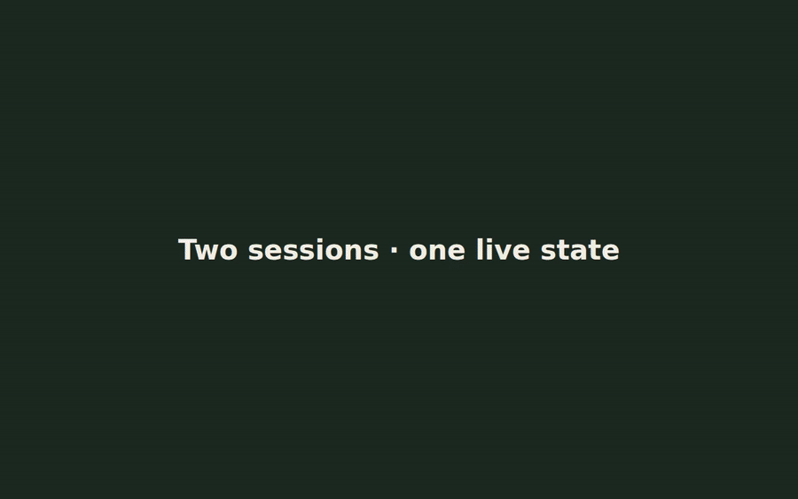
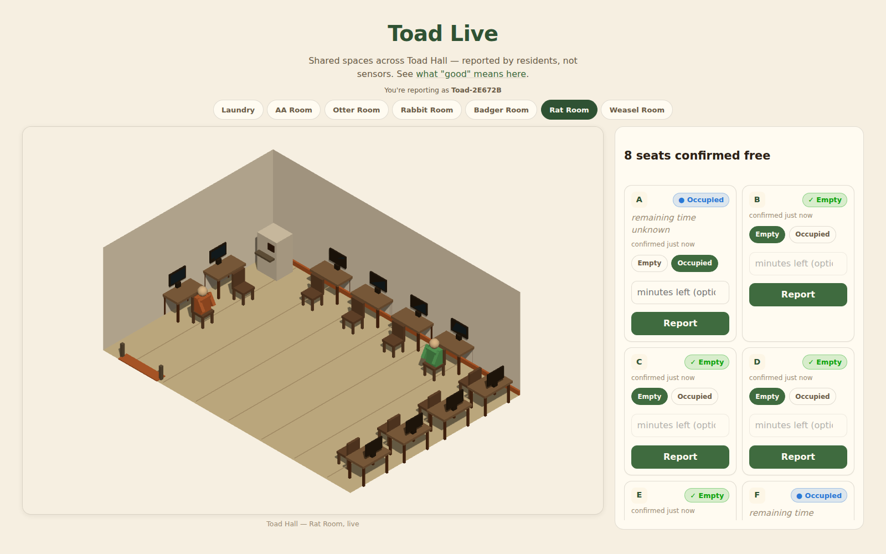
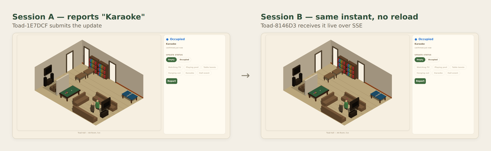

# Toad Live

**A real-time, multi-user status board for a shared residential building — seven facilities' worth of live state (ten laundry machines, study rooms, a music room, a computer lab's ten individual seats) kept accurate by whoever last reported, not by sensors.**

**Live demo:** https://comp4020-final-astra-erevos.fly.dev
**Repository:** https://github.com/comp4020-agentic-coding-studio/comp4020-final-astra-erevos

30–40s full demo: [MP4](docs/portfolio/demo/toad-live-demo.mp4) · [WebM](docs/portfolio/demo/toad-live-demo.webm) (adds a stale-write `409` rejection scene) — captured by a reproducible script, not hand-recorded; see [`docs/portfolio/demo/README.md`](docs/portfolio/demo/README.md).

## The problem

In a shared residential building, "is the washer free?" or "is the study room in use?" is usually answered by walking there and looking. Toad Live replaces that walk with a live, resident-reported status board: pick a facility, see its current state and report a change in a few seconds — no account, no sensor hardware. The real engineering problem isn't the CRUD surface; it's making human-reported, inherently stale information behave honestly under concurrent multi-user writes.

## Stack

- **Astro** (server-rendered pages + islands) on **Node**, deployed as a single container
- **SQLite** (`node:sqlite`) on a Fly.io persistent volume — no separate database server
- **Server-Sent Events** for real-time push to every connected session
- **Three.js**, one shared `WebGLRenderer` across seven live 3D scenes
- **Vitest** (264 tests) + **Playwright** for browser verification
- Deployed on **Fly.io** (one `shared-cpu-1x` machine, 256MB), CI on GitHub Actions

## How it works

The server reads state straight from SQLite for the first paint, then pushes every other session's reports live over SSE. A resident's own report goes out as a `PATCH` carrying the resource's `version`; if someone else wrote to it first, the server rejects with `409` and the current canonical state rather than silently overwriting anyone. Status is never trusted forever — an ordinary report lazily decays to "unknown" the next time anyone reads it, never on a timer — except a sticky state like out-of-order, which holds until a new report explicitly changes it.

Full request/write/broadcast flow: [`docs/portfolio/architecture.md`](docs/portfolio/architecture.md).

## Engineering highlights

**A CI flake that turned out to be a real architectural bug.** A docs-only commit failed CI seven times running, always `database is locked`. The cause: a test importing a room module for its pure decay logic was transitively opening a second live SQLite connection, racing the app's own for the same file lock. The fix was an architectural split — logic modules take an injected `store`/`now` and never touch the database layer directly. Zero lock errors since, across 15 repeated full test runs. ([`91167bd`](https://github.com/comp4020-agentic-coding-studio/comp4020-final-astra-erevos/commit/91167bd2a833c4cbe9d9399e45d8299ea537d16e))

**Catching a silent-overwrite hole before writing any code.** Optimistic concurrency was first designed to cover only resident reports. A design-time review caught that the server's own lazy decay transition is *also* a canonical mutation — a stale client report resurrecting an already-invalidated state would have been the exact silent-overwrite bug the versioning existed to prevent, one layer further down.

**A production incident that became a durable rule.** A malformed client timestamp, written unvalidated, made `node:sqlite` throw on every subsequent read of that row — one bad write 500'd it permanently, not just once. Fixed at the API boundary with a regression test, a live data repair, and a standing rule for any future client-supplied number. ([`3c0b63f`](https://github.com/comp4020-agentic-coding-studio/comp4020-final-astra-erevos/commit/3c0b63f0a73d01dae71d7fa1f9e6fe4d31057a32))

Full diagnosis and commit history for the CI-flake and concurrency highlights above, plus a third case — rejecting a shared room-level model for Rat Room's ten independently-reportable seats — are in [`docs/portfolio/case-studies.md`](docs/portfolio/case-studies.md).

## Testing and production evidence

- **264 automated tests** (Vitest) across 22 spec files, run against the same Docker image Fly deploys
- CI builds the production container, boots it, runs the full spec suite against it, and scans for committed secrets before any deploy
- Verified live at the demo URL above: real multi-session SSE checks (shown above), and a genuine server-restart reconnect test
- Eight architecture decision records in [`notes/adr/`](notes/adr/) — two cross-cutting (real-time/concurrency, identity) plus one per facility from AA Room through Rat Room

## Further reading

- [`docs/portfolio/architecture.md`](docs/portfolio/architecture.md) — system diagram and the real-time/persistence/concurrency design
- [`docs/portfolio/case-studies.md`](docs/portfolio/case-studies.md) — three engineering problems in more depth
- [`notes/adr/`](notes/adr/) — the full decision records, written as the project was built
- [`PROCESS.md`](PROCESS.md) — the development process and two incidents that changed how the project was built

---

*Toad Live was built as the final project for COMP8020 (Agentic Coding Studio, ANU). The brief set the premise (a status board for a residential community); the architecture, the engineering decisions, and the incidents above are the actual work.*
