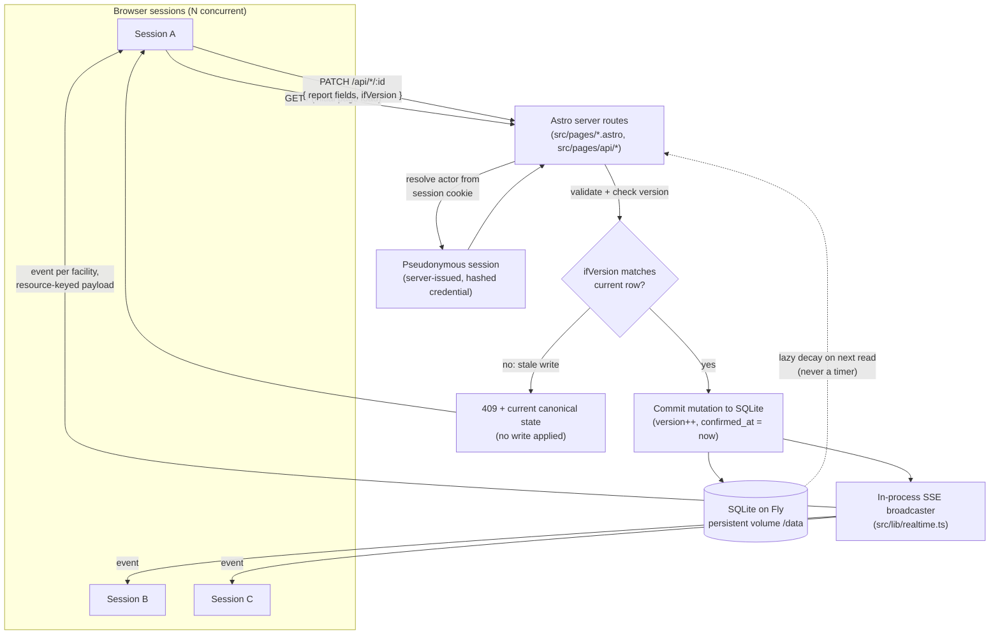
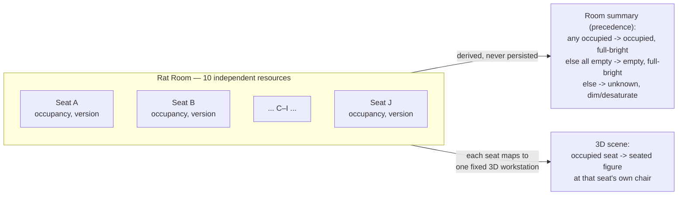

# Architecture

This explains Toad Live's actual request/write/broadcast flow, based on the implementation in `src/`. It's deliberately scoped to what's architecturally interesting — per-facility 3D rendering details and individual decay-threshold numbers are left to [`notes/adr/`](../../notes/adr/).

## System overview

**What each arrow actually is, in code:**

- `GET /` is server-rendered: `src/pages/index.astro`'s frontmatter reads current state directly from SQLite before the page is sent, so the first paint needs no client-side fetch.
- `PATCH /api/*/:id` (e.g. `src/pages/api/machines/[id].ts`, `src/pages/api/rat-room/[seat].ts`) resolves the actor from the session cookie — never from a client-supplied field — validates the body, and only then checks `ifVersion` against the row's current `version`.
- A successful write increments `version`, sets `confirmed_at`, and calls `broadcast()` from `src/lib/realtime.ts` — once, after the mutation has actually committed, never speculatively.
- `broadcast()` fans out to every subscriber in an in-process `Set` — correct specifically because this app runs as one Node process on one Fly machine with no horizontal scaling to reconcile across.

## Why SSE, not WebSockets or polling

Writes are one-directional (resident → server) and already go over plain `PATCH`; the only thing that needs to be push-based is the server telling every session "this resource just changed." WebSockets would add bidirectional plumbing nothing here uses. Polling would mean every open tab repeatedly asking "anything new?" on a fixed interval — real request churn, and a direct latency/frequency trade-off (poll often for low latency, or save requests and let reports go stale longer) that fights Fly's `min_machines_running = 0` scale-to-zero config (`fly.toml`'s own comment: stopping idle machines "is most of why the app costs cents, not dollars"). SSE avoids that churn: one open connection per session carries pushes as they happen, with no repeated request/response cycle to pay for on a timer.

## The persistence boundary

Everything that matters survives a restart: all shared state lives in SQLite on Fly's one persistent volume (`/data`), and `node:sqlite` needs no separate database server to provision. The **one explicit exception** is the SSE subscriber list itself — it carries no fact about any resource, is never written to disk, and is correctly and fully rebuilt from scratch on every reconnect. A client that was disconnected during an update doesn't miss it: reconnecting re-fetches current state directly, rather than replaying a missed event log that doesn't exist.

## Optimistic concurrency and 409 recovery

Every mutable resource (a machine, a room, a seat) carries a server-owned `version` counter starting at 1. A client never sets it — a `PATCH` only echoes the `version` it last saw as `ifVersion`. If that doesn't match the row's current version, the write is rejected outright with `409` and the row's actual current state, so the client can show the resident what really happened rather than silently losing their report or silently overwriting someone else's. This same check protects against **two** kinds of race, not just one: two residents reporting the same resource at once, *and* a resident's stale report racing the server's own background decay transition — decay is a canonical mutation too, and it increments `version` the same way a resident's report does.

## Lazy freshness decay

Nothing expires on a timer and nothing expires on a connection event. A resource's status is checked for staleness only when something actually reads it — an ordinary `GET`, a page load, or the moment right before a `PATCH` is applied. If it's past its threshold, it's rewritten to `unknown` as part of that same read, broadcast like any other change, and served fresh. This keeps "freshness" an honest property of the data rather than a best-effort background job that could silently fall behind.

## Rat Room: resource granularity as a real design decision

The seven facilities don't all share one state shape — each earned its own from its own real question. Laundry models ten independent machine resources, not one row. AA Room is a single occupancy row *plus* an independent set of combinable activity tags (watching TV and playing pool can both be true at once). Otter, Rabbit, Weasel, and Badger Room are the four facilities that do share one shape: a single row per room, `occupancy: empty | occupied | unknown`. Rat Room (a computer lab) breaks that pattern on purpose: the real question there isn't "is anyone in the room" (with ten seats, that's almost always true) but "how many seats are free for me specifically." A single room-level flag can't distinguish one occupied seat from ten — it collapses the one number a resident actually wants. Rat Room's state model is instead **ten independently-reportable seat resources** (A–J), each with its own `occupancy`/`confirmedAt`/`version` — structurally closer to Laundry's own multiple-machine-resources shape than to the four single-row rooms':

The room-level summary a resident sees ("N seats confirmed free") and the 3D scene's visual state are both computed fresh from the ten seats on every read — never persisted as a second, independent room-level fact that could drift from what the seats actually say. The 3D scene takes this one step further: each of the ten seats maps to one specific, fixed workstation in the rendered scene, so an occupied seat shows a figure at exactly its own chair — a deliberate design correction after an early version only showed a fixed decorative figure count unconnected to which seats were actually occupied.

## What's deliberately left out of this diagram

- Per-facility 3D figure/pose logic and furniture geometry — implementation detail, not system architecture (see the per-room files in `src/lib/hall-view/`).
- The shared Three.js renderer: one `WebGLRenderer` and one render loop for all seven 3D scenes (`src/lib/hall-view/renderer-host.ts`), switching between facilities by reparenting a canvas rather than creating a new WebGL context per facility. Worth knowing about, but it's a rendering-layer optimization, not a data-flow concern.
- The individual 15-minute/4-hour decay thresholds per facility — each is a real, independently-argued product decision; see each facility's own ADR rather than this diagram.
- CI/deploy pipeline internals — in short, CI builds the exact Docker image Fly deploys, boots it, and runs the full test suite against that running container before anything merges.
